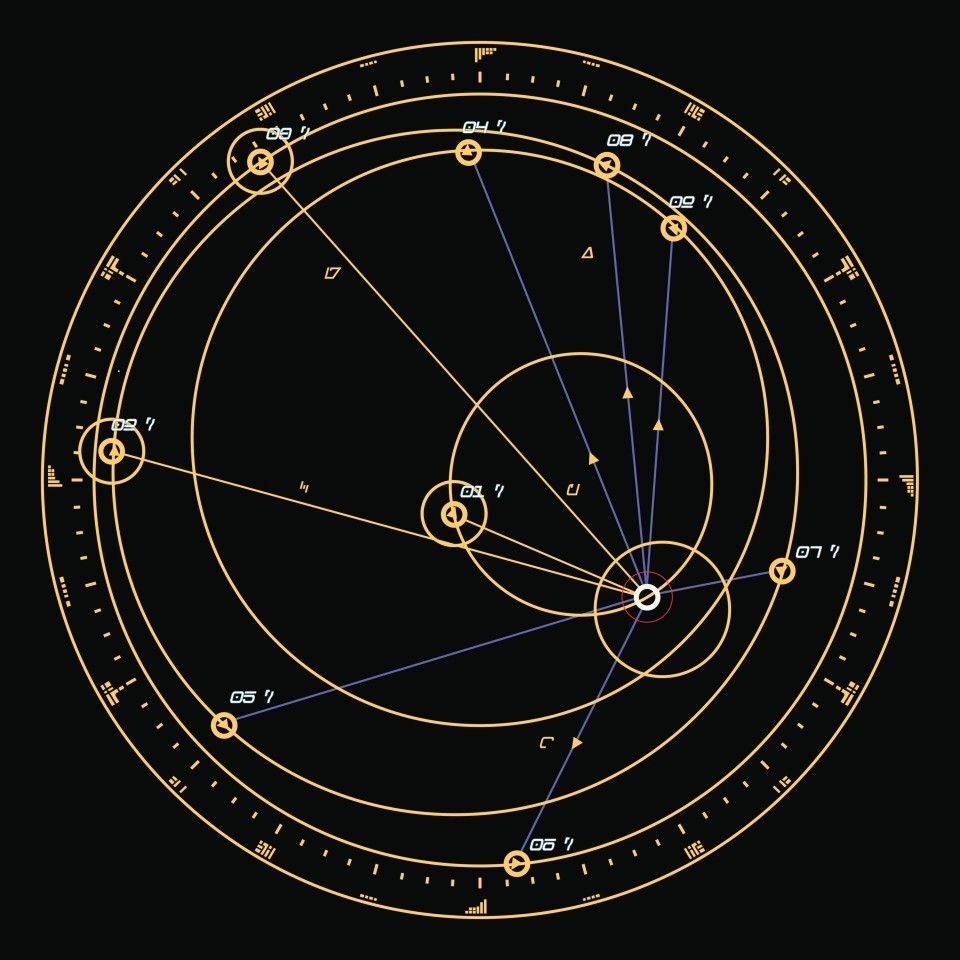

# ✦ M.P.E — Mouse Performático Estrelado (3D Astrolabe HUD)

> **Repositório Oficial:** [https://github.com/DevFLeo/Mouse-Performatico-Estrelado](https://github.com/DevFLeo/Mouse-Performatico-Estrelado)  
> **Gatilho Global Nativo:** `Shift + Ctrl + Alt + Botão Direito do Mouse`  
> **Executável Principal:** `MPE.exe` (Zero `localhost` • Ultraleve • Iniciar com o Windows • JSON Portátil na Raiz)



---

## 🚀 O que é o M.P.E?

O **M.P.E (Mouse Performático Estrelado)** é um sistema desktop de alta performance para Windows que invoca um **Astrolábio Orbital 3D Interativo** em **Degradê Preto & Dourado** ao pressionar **`Shift + Ctrl + Alt + Botão Direito do Mouse`**.

* **Círculo 3D Interativo:** Movimente o círculo para os lados arrastando o mouse, usando o Scroll ou as setas do teclado, com inclinação de perspectiva 3D e física inercial.
* **Pontos Estelares Configuráveis:** Cada estrela do mapa (`08 7`, `04 7`, `08 1`, `09 7`...) é um atalho salvo por você. Adicione quantos pontos quiser!
* **Automações Nativas:**
  * 📸 **Print + Envio para Conversa no Telegram com Caminho Salvo** (Tela inteira ou Recorte de área)
  * 🖼️ **Print Instantâneo** e **Recorte Interativo de Área**
  * 📝 **Seleção de Texto Inteligente** (captura automaticamente o texto selecionado na janela ativa anterior e permite copiar ou enviar ao Telegram)
  * 📁 **Abrir Pastas, Aplicativos (`.exe`), URLs e Comandos/Scripts**
* **Tela de Inicialização Cinematográfica:** Exibe **`"M . P . E   Inicializando"`** seguido de **`"Bem-vindo, [Nome definido no cadastro e salvo no JSON]"`**.
* **3 Modos de Linguagem em Tempo Real:**
  1. **Amigável** (Calorosa e próxima)
  2. **Neutra (Interpessoal)** (Inclusiva e equilibrada)
  3. **Profissional** (Executiva e técnica)
* **Portabilidade Inteligente:** Salva configurações por máquina (`%APPDATA%` + ID da máquina), mas sincroniza tudo no arquivo **`mpe.config.json`** na raiz do projeto para migração imediata entre computadores.

---

## 📚 Documentação Técnica Detalhada (Os 3 Markdowns Principais + Pitch)

1. 📄 **[1-SISTEMA-ARQUITETURA.md](1-SISTEMA-ARQUITETURA.md)** — Detalhamento técnico profundo do que cada pasta, binário Win32 (`MpeHook.exe`, `MPE.exe`), pipeline IPC e cálculo de projeção 3D significa.
2. 📄 **[2-COMO-SALVAR-ATALHOS.md](2-COMO-SALVAR-ATALHOS.md)** — Guia completo passo a passo de como criar, editar e salvar novos pontos estelares, configurar Print, Seleção de Texto, Telegram e migrar entre máquinas via JSON.
3. 📄 **[3-COMO-MODIFICAR-PROJETO.md](3-COMO-MODIFICAR-PROJETO.md)** — Guia de engenharia sobre como modificar ou alterar o projeto, adicionar novas ações, customizar o motor 3D e recompilar os executáveis nativos.
4. 🌟 **[PITCH.md](PITCH.md)** — O Pitch Executivo, Comercial e Técnico do M.P.E.

---

## ⚡ Como Iniciar Agora Mesmo

1. **Pelo Executável Nativo (Sem Terminal):**
   Basta dar duplo clique em **`MPE.exe`** na raiz do projeto (`c:\Projetos\MousePerformaticoEstrelado\MPE.exe`).
2. **Ou via NPM:**
   ```powershell
   npm start
   ```
3. **Para acionar o Astrolábio 3D a qualquer momento:**
   Pressione **`Shift + Ctrl + Alt + Botão Direito do Mouse`** (ou `Ctrl + Shift + Alt + M`, ou clique no ícone dourado na Bandeja do Sistema do Windows).
